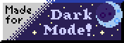
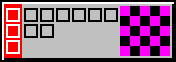
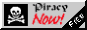
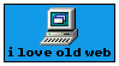
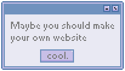
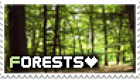
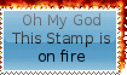

**Hi there!** 👋

I'm [Michi](https://michi.onl), a business informatics engineer from Germany.
I build well-designed, performant software, localize open-source apps and run a personal homelab.
I like the handmade web.

## Things i like:

### Privacy & Security

### Open Source Projects & Tools

### The Old/Small/Indie/Geocities Web

### Web Culture & Web Archive

### Handmade Web

### Fediverse & Digital Ethics

### Values

## Stamps

